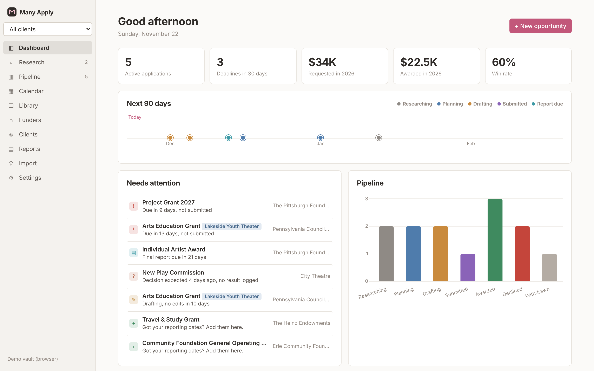
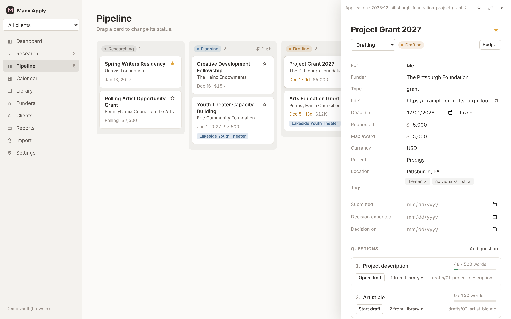
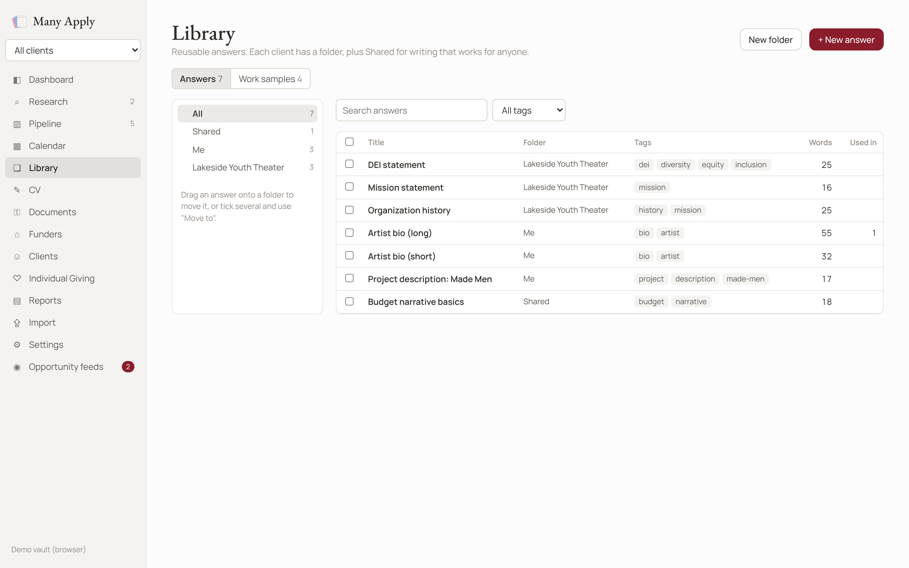
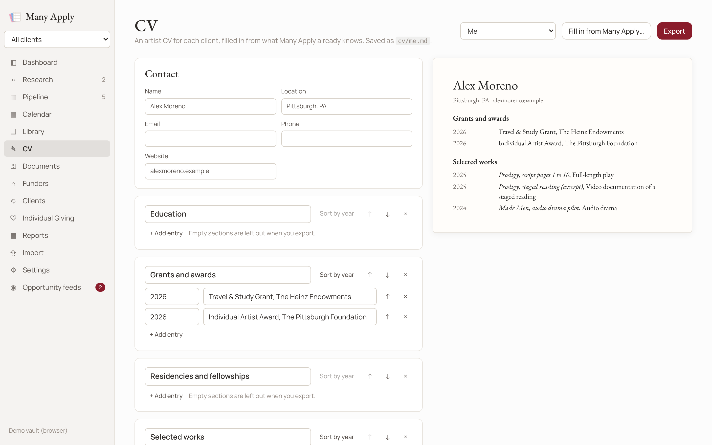
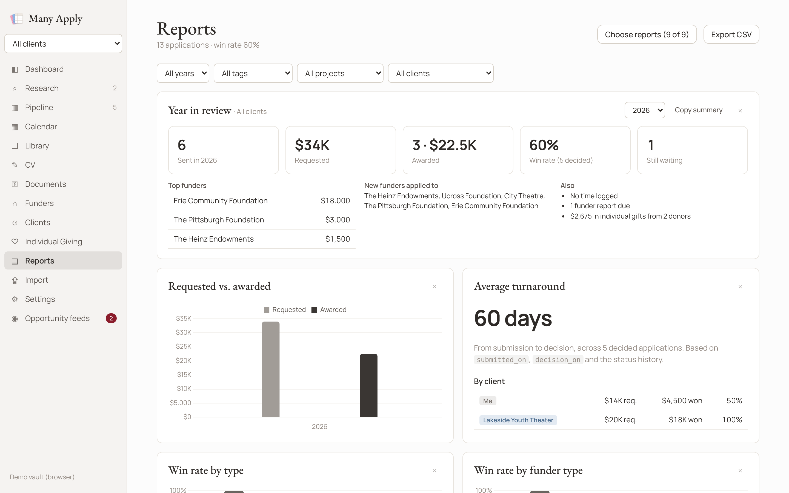
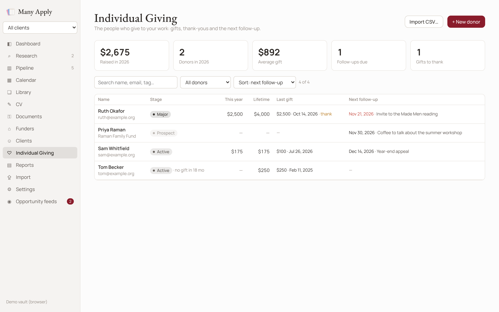

# Many Apply

A free desktop app for individual artists and solo grant writers to research, track and write grants in one place. It's the sibling of Many Write: Many Write is for the writing, Many Apply is for the tracking, deadlines and data.



- **$0 to build, $0 to use.** No servers, no accounts, no cloud costs.
- **Local-first.** Everything lives in a folder on your computer as plain markdown files you own. Put the folder in iCloud or Dropbox if you want it on more than one computer.
- **No AI.** Everything is manual, plus simple pattern matching for dates and dollar amounts.
- **Open source** (MIT).

## Install

Download the latest build from [Releases](../../releases). v1 builds are unsigned, so your computer will warn you the first time:

- **Mac:** open the `.dmg`, drag Many Apply to Applications, then **right-click the app → Open → Open**. You only do this once.
- **Windows:** run the `.msi` or `.exe`. If SmartScreen appears, click **More info → Run anyway**.
- **Linux:** use the `.AppImage` (make it executable) or the `.deb`.

On first launch, choose a folder for your vault (an empty folder is fine), or explore with sample data.

## What's in it

| Screen | What it does |
| --- | --- |
| Dashboard | Active applications, deadlines in 30 days, requested and awarded this year, win rate. A 90-day deadline timeline, a pipeline chart, and a Needs Attention list. |
| Research | Everything with status `researching`, as cards or a list. Quick-add with paste-in pattern matching for dates, amounts and links. Star, filter, "Move to Pipeline". |
| Pipeline | Kanban board by status (drag to change status) or a sortable table. |
| Grant drawer | Opens from any list. Every field editable inline, questions with word-count meters and drafts, Library suggestions, Materials (the Library answers, work samples and documents sent with it, plus files dropped straight onto it), reporting dates, budget summary, Todoist tasks, status history. Pin it open or expand it to full screen. "Export for review" saves every question and draft (plus the work sample list and budget summary) as one Word document, to send a client to comment on or edit with tracked changes. |
| Draft editor | A calm writing surface with a word or character limit meter, "Insert from Library" (records `used_in`) and "Insert field" for client profile fields. |
| Budget builder | Line items with optional quantity × rate, categories, types (Expense, Income, In-kind), live totals and gap, "set amount requested from the gap", a warning over the funder's max, CSV export with totals, copy as a table, start from a Library budget or a past application's budget. Saved as `budget.csv`. |
| Calendar | Month and agenda views of deadlines, submissions, expected decisions and report due dates. `.ics` export, plus a live `.manyapply/calendar.ics` you can subscribe to. |
| Library | Four tabs. **Answers:** reusable writing in a folder tree: Shared, plus one folder per client, plus any subfolders you add. Drag to move, pick a folder in an answer's drawer, or tick several and "Move to…". "Duplicate to…" another client. Moving keeps every application that uses it linked. **Work samples:** images, video, audio, PDFs and links (Vimeo, YouTube, SoundCloud…) with year, medium, dimensions or running time, credits and a description. Drop files in, preview and play them in the app, copy a caption, and see which applications each sample was sent with. **Budgets:** budgets for projects, not tied to any application, built in the same budget builder; copy one into an application, start any budget from it, or set one as a client's default. **Documents:** see below. |
| Documents (in the Library) | Contracts, tax forms and legal paperwork applications ask for again and again: W-9, 501(c)(3) letter, fiscal sponsor agreement, insurance certificates, tax returns. Choose which client they're for, upload or drop files, set an expiry date and the Dashboard warns you before it runs out. A note on the screen explains who can see these files if your vault syncs through Dropbox or iCloud. Never included in "Share client folder". |
| CV | An artist CV for each client, saved as `cv/<client>.md`. Every awarded application goes on by itself (grants and awards, or residencies and fellowships); take one off and it stays off until you add it back. "Add work samples" fills Selected works. A live preview, then export to Word, copy as plain text, or save a copy to the Library to attach to applications. |
| Opportunity feeds | A panel you open from the sidebar with new grants and open calls from RSS and Atom feeds, with a badge for new items. Starts with ArtDeadline and NYC Playwrights; turn any of them off, filter by keywords, or add your own feeds. "Save to Research" turns an item into an opportunity, with any deadline and amount it can spot. Feeds are only read; nothing about you is sent. |
| Individual Giving | A small donor CRM: gifts, thank-yous, touchpoints and the next follow-up for each person, and who they gave to (you or a client), so the client switcher filters donors too. Import donors and gifts from a CSV (PayPal, Stripe, Givebutter or a spreadsheet) to you or a client: rows for the same person are merged, existing donors for that client are matched by email or name, gifts already logged are skipped, and you can undo. Export to CSV for you, one client or everyone: one row per donor, or one row per gift. |
| Funders | Every funder with totals (applied, awarded, win rate) and every grant sent to them. |
| Clients | For freelance grant writers. A client switcher at the top of the sidebar filters every screen. Profiles, per-client budget templates and Todoist projects, and "Share client folder" as a zip. |
| Reports | Year in review (with a copyable summary), requested vs. awarded by year, win rate by type and funder type, funding by funder, a deadline heatmap, average days to decision, individual giving (retention, new vs. returning donors, top donors) and document readiness (which standard documents each client is missing or about to lose). Show or hide each report. Filter by year, tag, project and client. CSV export. |
| Import | A plain-language guide next to a CSV importer for Notion, Google Sheets, Excel and Airtable exports: column matching, status matching, preview with warnings and duplicate detection, saved mappings, one-click undo. Export everything back to CSV. |
| Settings | Vault folder, themes (light, dark, pink, build your own), chart and status colors (palettes, or pick each one), Todoist token (kept in the OS keychain), prep-task template, backup to zip, Chrome extension download and pairing. |

## Screenshots

| | |
| --- | --- |
|  |  |
| **Application drawer:** everything about one application, including the materials that go with it. | **Library:** reusable answers and work samples, a folder per client. |
|  |  |
| **CV builder:** filled in from awarded grants and work samples. | **Reports:** year in review, win rates, funders, giving and document readiness. |
|  | |
| **Individual Giving:** donors, gifts, thank-yous and follow-ups. | |

## The vault

```
Many Apply/
  grants/
    2027-02-pittsburgh-foundation-project-grant/
      grant.md
      budget.csv
      drafts/
        01-project-description.md
      attachments/
  clients/
    me.md
    lakeside-youth-theater.md
  library/
    shared/
    me/
    lakeside-youth-theater/
    budgets/              (budget templates, as CSV)
  samples/                (work samples: a .md file per sample, with its media file next to it)
    shared/
    me/
      river-suite.md
      river-suite.jpg
  documents/              (contracts, tax and legal files: a .md file per document, with its file next to it)
    me/
      w-9.md
      w-9.pdf
  donors/                 (one .md file per donor, with their gifts)
  cv/
    me.md
  funders/
    pittsburgh-foundation.md
  .manyapply/
    settings.json
    calendar.ics          (kept up to date, if turned on)
    imports/              (import logs, used for undo)
    trash/                (nothing is hard-deleted)
```

Grant folders are named `YYYY-MM-funder-title` from the deadline, so they sort by date in any file browser. The folder is renamed if the deadline or funder changes.

`grant.md` is YAML frontmatter plus a markdown body. See [docs/vault-format.md](docs/vault-format.md) for every field. The short version:

- **`status` drives everything:** the board columns, chart counts and Needs Attention list. Changing it in the app appends to `status_history`, which powers the turnaround report.
- **`reports`** starts empty. Add reporting dates whenever they arrive, usually in the award email. Mark one done by filling in `submitted_on`.
- **Edit files anywhere.** The app watches the folder, so changes made in Obsidian or a text editor show up straight away. Unknown frontmatter keys are kept.

The app keeps everything in memory and rebuilds it from the files on launch, so there's no database to corrupt.

## Todoist (optional)

Paste your personal API token in Settings (Todoist → Settings → Integrations → Developer). It's stored in your operating system's keychain, never in the vault. Sync is one-way:

- When an application moves to **Planning**, Many Apply adds a task due on the deadline, plus prep tasks from your template (by default: gather work samples 14 days before, final draft 3 days before).
- When you add a **reporting date**, it adds a task for that date, plus a reminder 14 days before.
- With "project per client" on, each client's tasks go in their own Todoist project, created on first use.

Task IDs are saved in `todoist_task_ids`.

## Chrome extension

The `extension/` folder is a Manifest V3 extension that saves the page you're on as a new opportunity. Highlighted text goes into Eligibility or Questions, and dates and dollar amounts on the page are offered as suggestions.

1. Go to `chrome://extensions`, turn on **Developer mode**, click **Load unpacked** and choose the `extension` folder (or unzip `extension.zip` from a release).
2. In Many Apply, open **Settings → Chrome extension** and copy the six-digit pairing code into the extension.

The extension talks only to the desktop app on `127.0.0.1:47321`, and every request needs the pairing code. If the app is closed, grants wait in the extension and are sent when it opens. Nothing leaves your computer.

## Develop

Requirements: Node 20+, Rust (stable), and the [Tauri prerequisites](https://v2.tauri.app/start/prerequisites/) for your OS.

```bash
npm install
```

```bash
npm run tauri dev      # desktop app with hot reload
```

```bash
npm run dev            # browser preview at http://localhost:1420, with a demo vault in localStorage
```

```bash
npm test               # unit tests (vitest)
```

```bash
npm run tauri build    # installers for your OS, in src-tauri/target/release/bundle
```

Pushing a tag like `v0.1.0` runs `.github/workflows/release.yml`, which builds Mac, Windows and Linux installers and the extension zip, and attaches them to a draft GitHub Release.

### Layout

```
src/
  lib/          vault format, parsing, stats, CSV import, budget, Todoist, pattern matching
  lib/fs/       one filesystem interface, with Tauri and in-memory (browser preview) backends
  components/   drawer, cards, tables, inline editors
  screens/      one file per screen
  store.ts      app state (zustand)
src-tauri/      Rust shell: keychain, opening links, the extension listener
extension/      Chrome extension
tests/          unit tests
```

## Not in v1

AI features; accounts, cloud sync and teams (put the vault in your own iCloud or Dropbox folder instead); fuller post-award management such as deliverables and spending against budget. Reporting dates are in v1.
